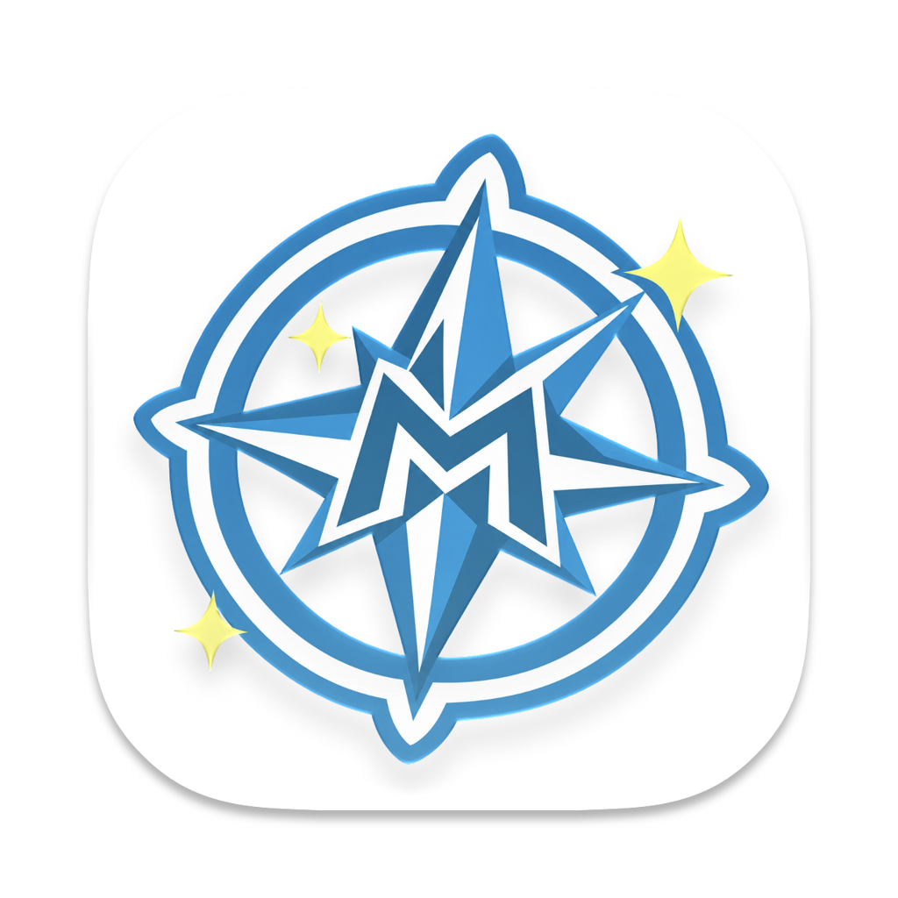
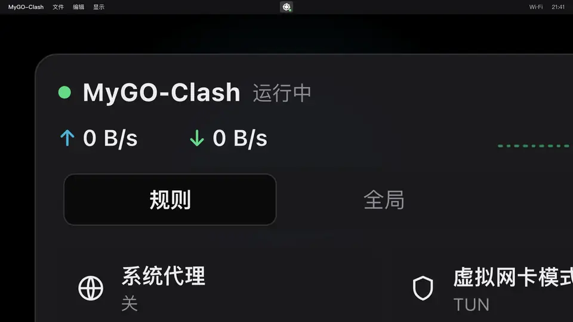

<p align="center">
  
</p>

<h1 align="center">MyGO-Clash</h1>

<p align="center">
  基于 <a href="https://github.com/MetaCubeX/mihomo">mihomo</a> 内核与 <a href="https://github.com/egoist/mygo">MyGo</a> 框架的跨平台代理客户端<br>
  <i>迷子でもいい、前へ進め。</i>
</p>

<p align="center">
  <b>简体中文</b> · <a href="README.en.md">English</a> · <a href="README.ja.md">日本語</a>
</p>

<p align="center">
  
  
  
  
</p>

<p align="center">
  <a href="docs/showcase/promo.mp4"></a>
</p>

<p align="center"><sub><a href="docs/showcase/promo.mp4">观看 30 秒宣传片（MP4，有声）</a> · <a href="docs/showcase/hero-dark.gif">快捷面板速览（GIF）</a> · <a href="docs/showcase/hero-light.gif">浅色主题（GIF）</a></sub></p>

> [!NOTE]
> 从 1.0 起，MyGO-Clash 的主窗口由 MyGo 原生绘制。界面和主要功能已在 macOS（Apple Silicon）和 Windows 上实际使用；Linux 已在 Fedora 上实际测试，其他发行版众多，尚未逐一测试。遇到问题欢迎提 [Issue](https://github.com/Souitou-iop/MyGO-Clash/issues)。

## 功能

### 代理

- 内置 mihomo 内核，作为独立进程运行；开启 TUN 模式时会引导安装系统服务（只需一次管理员授权），应用更新后会提示同步更新服务
- 规则、全局、直连三种模式，在首页、托盘、快捷面板和全局快捷键里都能切换
- 系统代理：绕过列表、PAC 脚本，被其他软件改掉时自动恢复
- TUN：Mixed、gVisor、System 三种协议栈，自动路由、严格路由、DNS 劫持、排除网段
- 节点延迟测试与自动测速，切换节点或模式时可自动断开旧连接
- 局域网共享、IPv6、进程匹配，以及供 Web 面板使用的外部控制器

### 订阅与配置

- 远程订阅：显示已用流量和到期时间，定时自动更新，无法直连的订阅可以通过代理更新
- 本地配置文件，内置 YAML 编辑器
- 扩展：全局或单个配置的 YAML 合并、JavaScript 脚本，以及规则、节点、代理组的前置、追加、删除
- 从分享链接（vmess://、ss://、trojan://、vless://、hysteria2://、wireguard://、snell://、ssh:// 等）、剪贴板或二维码图片导入节点
- 点击 `clash://install-config?url=…` 链接一键导入订阅

### Tailscale

- 内置用户态 Tailscale 节点：不用另装软件，也不需要管理员权限；也可以接管本机已安装的 Tailscale
- 通过规则使用子网路由和出口节点，支持 MagicDNS，以及 Headscale 等自建控制服务器
- 同一账号的其他设备可以通过 Tailscale 地址使用这台电脑的代理
- 让 TUN 模式和 Tailscale 互不干扰

### 同步与备份

- 通过任意 WebDAV 服务（Nextcloud、坚果云、群晖、InfiniCLOUD……）在多台电脑间同步订阅和设置
- 端到端加密：口令经 Argon2id 派生密钥，每个文件用 XChaCha20-Poly1305 加密，文件名也经过隐藏
- 同一份订阅在两台设备上都改过时会提示冲突，设置则按字段合并；TUN、快捷键等设备相关的设置不参与同步
- 备份到本地或 WebDAV，也可以导出为加密文件

### 实用工具

- 解锁检测：Netflix、Disney+、YouTube Premium、ChatGPT、Claude、Gemini、Spotify、TikTok、Steam 货币区
- 出口 IP 查询与常用网站连通性检测
- 连接、规则、日志页面

### 桌面体验

- 托盘菜单（模式、节点、订阅、Tailscale）、托盘网速、原生快捷面板、全局快捷键
- 首页卡片可以自由开关、排序，布局随窗口宽度自动调整
- 浅色、深色主题和多种强调色，可自定义字体与 CSS
- 界面支持 15 种语言：简体中文、繁體中文、English、日本語、한국어、Русский、Español、Português (Brasil)、Deutsch、Français、Türkçe、Bahasa Indonesia、Tiếng Việt、فارسی、العربية；波斯语和阿拉伯语使用从右到左的镜像布局
- 窗口不在前台时，错误和警告通过系统原生通知提示，点击直接打开相关页面
- 轻量模式：关闭主窗口以节省内存，内核、托盘和快捷面板照常运行
- 开机自启、静默启动，一键复制终端用的代理环境变量
- 订阅地址、密码等敏感信息加密保存，密钥放在系统的安全存储中（macOS 钥匙串、Windows DPAPI、Linux Secret Service）
- Windows 上可一键解除 Microsoft Store 应用的回环限制
- macOS 26 及以上，应用图标跟随系统的浅色、深色、透明和着色外观
- 应用自动更新：可设置是否自动检查、检查频率（每小时到每月）和是否自动下载安装；更新包经过签名校验，并支持只下载变化部分的增量更新

## 命令行与 MCP（给脚本和 AI Agent 用）

应用运行时会在数据目录里开一个本机控制 socket，同一个可执行文件既是命令行（`ctl`），也是 MCP 服务器（`mcp`）。脚本、Claude Code 之类的 Agent 都能查状态、切节点、开关代理，不用点界面。

可执行文件位置：

| 系统 | 路径 |
|---|---|
| macOS | `/Applications/MyGO-Clash.app/Contents/MacOS/MyGO-Clash` |
| Windows | `%LOCALAPPDATA%\Programs\MyGO-Clash\MyGO-Clash.exe` |
| Linux（deb / rpm / Arch） | `mygo-clash` |

下文用 `mygo-clash` 指代它（macOS 可以 `alias mygo-clash=/Applications/MyGO-Clash.app/Contents/MacOS/MyGO-Clash`）。

```bash
mygo-clash ctl status                      # 内核、系统代理、TUN、模式、订阅、当前出口
mygo-clash ctl groups                      # 策略组；ctl groups Proxy 列出组内节点和延迟
mygo-clash ctl select Proxy "🇭🇰 HK 01"     # 选节点
mygo-clash ctl delay --group Auto          # 测整组延迟；ctl delay <节点> 测单个
mygo-clash ctl proxy on                    # 系统代理；ctl tun on|off、ctl mode rule|global|direct
mygo-clash ctl conns github --limit 10     # 连接；ctl close <id>… 或 ctl close --all
mygo-clash ctl traffic                     # 实时速率与总量；ctl stats 7d 看统计
mygo-clash ctl profiles                    # 订阅列表（地址已掩码）；import <url>、update --all、use <名称>
mygo-clash ctl settings clash.mixedPort    # 读设置；ctl set clash.allowLan=true 改设置
mygo-clash ctl logs -n 50 --level warning  # 日志尾部
mygo-clash ctl tailscale                   # Tailscale 状态和设备
mygo-clash ctl --json status               # 任何命令加 --json 输出 JSON
```

退出码：0 成功，1 出错，2 用法错误，3 应用未运行（`ctl launch` 可在后台启动它）。`ctl methods` 列出全部方法，`ctl call <方法> '<JSON>'` 直接调用。

**MCP**：`mygo-clash mcp` 通过 stdio 提供 23 个工具（状态、节点、测速、连接、订阅、设置、日志、Tailscale 等），每个工具都带说明和输入 schema。删除订阅、改设置这类危险操作在描述里标了 DANGEROUS，并带 `destructiveHint` 标注。应用没在运行时，可调用 `app_launch` 启动。Claude Code 配置示例：

```bash
claude mcp add mygo-clash -- /Applications/MyGO-Clash.app/Contents/MacOS/MyGO-Clash mcp
```

Claude Desktop、Cursor 等客户端用 JSON 配置：

```json
{
  "mcpServers": {
    "mygo-clash": {
      "command": "/Applications/MyGO-Clash.app/Contents/MacOS/MyGO-Clash",
      "args": ["mcp"]
    }
  }
}
```

安全：

- 不监听任何网络端口。socket 放在只有当前用户能进入的数据目录里（权限 0600）；每次启动生成新的随机令牌，写进同目录的 `control.token`（0600），每次调用都要带上它
- 控制器密钥、局域网认证密码、WebDAV 地址与用户名、Tailscale 控制服务器地址一律显示为 `[redacted]`；订阅地址只保留协议和域名，错误信息和日志里出现的网址同样掩码。带 `[redacted]` 的补丁会被拒绝，避免把掩码写回去
- 默认开启，可随时关闭：`mygo-clash ctl set agent.enabled=false`，或在 `settings.json` 里把 `agent.enabled` 设为 `false`。这个开关只作用于本机，不参与同步
- 开发版加 `--dev`（`ctl --dev …`、`mcp --dev`）连接开发构建

## 下载

可以从 [Releases](https://github.com/Souitou-iop/MyGO-Clash/releases) 页面下载最新版本，也可以从源码构建（见下文）：

| 系统 | 安装包 | 自动更新 |
|---|---|---|
| macOS 12+（Apple Silicon / Intel） | `.dmg` | 支持 |
| Windows 10/11（x64 / ARM64） | 安装程序 `Setup.exe` | 支持 |
| Linux（x64 / ARM64） | `.tar.gz` 配合 `install.sh`，安装到 `~/.local` | 支持 |
| Debian / Ubuntu | `.deb` | 由软件包管理器更新 |
| Fedora / openSUSE | `.rpm` | 由软件包管理器更新 |
| Arch Linux | `.pkg.tar.zst`（`sudo pacman -U`） | 由软件包管理器更新 |
| 其他发行版 | `.AppImage` | 下载新版本替换 |

Linux 需要 GTK 3 和 libayatana-appindicator（托盘图标）。deb、rpm 和 Arch 包会自动安装这些依赖，AppImage 和 tar.gz 需要系统里已经有。

目前安装包还没有代码签名：macOS 首次打开请右键选择「打开」，Windows 可能会弹出 SmartScreen 提示。

## 从源码构建

需要：

- [Go](https://go.dev/dl/) 1.27.3 或更高版本
- [Bun](https://bun.sh)
- Linux：GTK 3，例如 Debian / Ubuntu 上 `sudo apt install libgtk-3-0`

```bash
git clone https://github.com/Souitou-iop/MyGO-Clash.git
cd MyGO-Clash
bun run dev     # 开发模式，修改后自动重新构建
bun run build   # 打包当前平台，输出到 build/
```

请通过 `package.json` 里的脚本构建：它们会加上 mihomo 需要的 `-tags=with_gvisor`。修改 `internal/app/locales` 里的翻译后，用 `bun run generate` 重新生成 Go 里的文案目录。

Go 不需要 cgo，所以在一台 Mac 上就能构建所有平台：

```bash
bun run build -platform darwin/arm64,windows/amd64,windows/arm64,linux/amd64,linux/arm64
go run -C tools/linuxpkg . "$PWD/build/linux-amd64" "$PWD/build/linux-arm64"   # rpm、Arch 包和 AppImage
```

macOS 的 DMG 只能在 macOS 上生成。Windows 安装程序需要 NSIS（`brew install makensis`），AppImage 需要 squashfs-tools（`brew install squashfs`）。

推送 `v0.2.0` 这样的版本标签后，GitHub Actions（`.github/workflows/release.yml`）会构建所有平台，签名更新包，并上传到 Release 草稿；发布草稿后，已安装的应用就会更新到这个版本。签名密钥用 `go tool mygo keygen` 生成，放在仓库的 `MYGO_UPDATER_PRIVATE_KEY` secret 里，更新说明取自 `CHANGELOG.md`。

应用图标来自 Icon Composer 文件。修改设计后，在装有 Xcode 26 或更高版本的 Mac 上运行下面的命令，重新生成 macOS 的 `Assets.car`、其他平台用的 `icon.png`：

```bash
go run ./cmd/genicon path/to/MyGo-Clash.icon
```

## 项目结构

```
main.go              入口：同一个可执行文件运行应用、内核（core）或特权服务（service）
internal/app         主窗口与快捷面板（原生界面）、托盘、通知与设置
internal/corehost    运行 mihomo 内核
internal/coremgr     以独立进程或系统服务的方式管理内核
internal/service     TUN 所需的特权服务
internal/profiles    订阅与配置文件
internal/enhance     合并、脚本等配置扩展
internal/tailnet     Tailscale 集成
internal/cloudsync   端到端加密同步
internal/sysproxy    系统代理
design/              应用图标的设计源文件
cmd/genicon          从 Icon Composer 文件生成各平台图标
tools/linuxpkg       生成 rpm、Arch 包和 AppImage（独立的 Go 模块）
```

## 致谢

- [mihomo](https://github.com/MetaCubeX/mihomo)：代理内核
- [MyGo](https://github.com/egoist/mygo)：跨平台桌面应用框架
- [Tailscale](https://tailscale.com)：组网能力
- [MyIP](https://github.com/jason5ng32/MyIP)：连通性页的布局与站点预设
- [ipapi.is](https://ipapi.is) 与 [proxycheck.io](https://proxycheck.io)：IP 质量数据

## 声明

- MyGO-Clash 是非官方的同人致敬项目。名称、配色以及罗盘图案致敬《BanG Dream!》中的乐队 MyGO!!!!!，与 Bushiroad 及乐队官方没有任何关系。
- 本软件仅供学习和研究网络技术使用，请遵守所在地区的法律法规。

## 许可证

[GPL-3.0](LICENSE)
